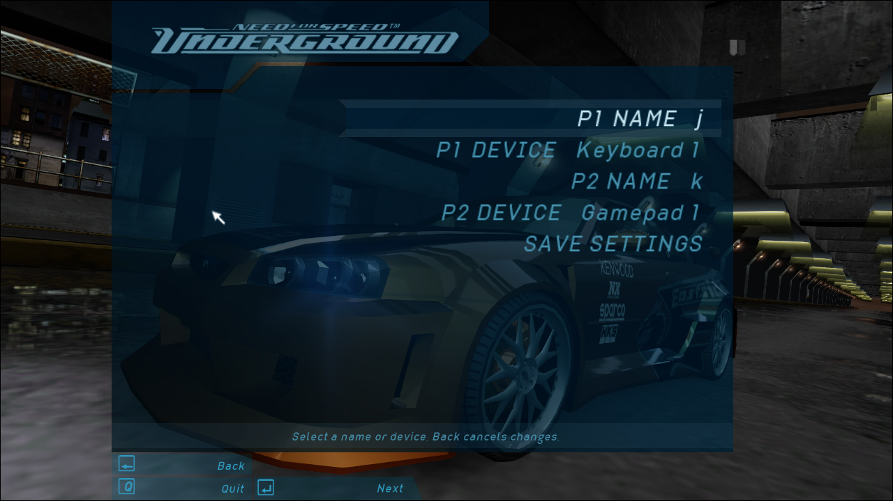

# Need for Speed: Underground — Split Screen

**Two players. One PC. Olympic City.**

Play the original *Need for Speed: Underground* together on one Windows PC, with a horizontal split screen, separate cameras and a HUD for each driver. Pick cars from a shared garage and bring your custom builds into the race.

[](https://github.com/nuvsyakoetakoe/nfs-underground-split-screen/releases/latest)
[](https://github.com/nuvsyakoetakoe/nfs-underground-split-screen/releases)

**[Download ZIP](https://github.com/nuvsyakoetakoe/nfs-underground-split-screen/releases/latest/download/NFSU-SplitScreen.zip)** · [Installation](#installation) · **[Русский](docs/README.ru.md)**


## Features

- **Local two-player racing** — horizontal split screen on a single PC.
- **A view for each driver** — separate cameras, speedometers, race positions and minimaps.
- **Shared garage** — choose stock cars or saved custom builds. Both players can drive the same model with different tuning.
- **Player setup in the game menu** — set nicknames and assign input devices in **Options → Split Screen Options**.
- **Keyboard and XInput controls** — start with a keyboard and a gamepad, or assign two XInput gamepads.
- **Widescreen Fix included** — select your resolution in **Options → Display**; the game remembers it for the next launch.

## Installation

1. Prepare a **clean Windows PC installation of Need for Speed: Underground, patch 1.4**. Back up the game folder before installing: the mod replaces menu and shader resources.
2. Download **[NFSU-SplitScreen.zip](https://github.com/nuvsyakoetakoe/nfs-underground-split-screen/releases/latest/download/NFSU-SplitScreen.zip)** from the latest release. The GitHub **Source code** archives are for developers.
3. Extract the ZIP into the folder containing `Speed.exe`, preserving the folder structure. Allow the included files to be replaced.
4. Launch `Speed.exe` normally. Widescreen Fix and Ultimate ASI Loader are already bundled.

The archive adds `dinput8.dll` and `d3dx9_43.dll` beside `Speed.exe`, plugins under `scripts`, and modified resources under `FrontEnd` and `fx`. If those files already belong to another mod, use a separate clean game copy first.

## Start a race

1. Open **Options → Split Screen Options**.
2. Set **P1 Name / P2 Name** and choose each player's **Device**. For a first race, use a keyboard for player one and an XInput gamepad for player two.
3. Select **Save Settings**. Going back without saving cancels the changes.
4. Choose **Split-Screen** from the main menu, select a race, then choose a car for each player in turn.



Names and device assignments are stored in `SplitScreenOptions.ini` beside `Speed.exe`.

## Compatibility

| Game | Version | Language |
| --- | --- | --- |
| Need for Speed: Underground (2003), Windows PC | 1.4 | EN |

## Settings

- **Resolution:** **Options → Display**. Startup movies are enabled by default.
- **Widescreen options:** `scripts/NFSUnderground.WidescreenFix.ini`. Keep the bundled version for the verified setup; newer upstream features may differ.
- **Uninstall:** restore your backed-up game folder. Removing only the ASI plugin does not restore the replaced menu and shader files.

## Build from source

The split-screen plugin, menu modifications and shader build scripts are included in this repository. Building requires Windows, **Zig 0.13.0**, **Python 3** and original assets from your own clean game installation.

```powershell
.\build.ps1 -GameDir "C:\Games\NFS Underground" -Package
```

[Build instructions, offline packaging and test launch →](docs/BUILD.md)

## Credits

- **Split-screen plugin, menu changes and build scripts:** [nuvsyakoetakoe](https://github.com/nuvsyakoetakoe).
- **NFS Underground Widescreen Fix:** ThirteenAG and contributors — [bundled build source](https://github.com/ThirteenAG/WidescreenFixesPack/tree/dd0d6c9) · [upstream project](https://github.com/ThirteenAG/WidescreenFixesPack).
- **Ultimate ASI Loader:** ThirteenAG and contributors — [bundled version source](https://github.com/ThirteenAG/Ultimate-ASI-Loader/tree/6b44066).
- **Direct3D 9 Extensions runtime:** Microsoft.

[Third-party licenses](docs/licenses). An unofficial fan mod for the original game by EA Black Box and Electronic Arts. The original game is required and is not included.
