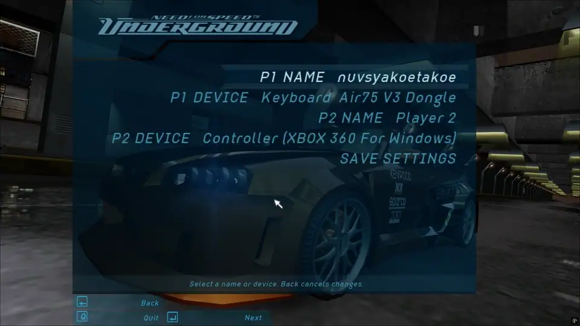
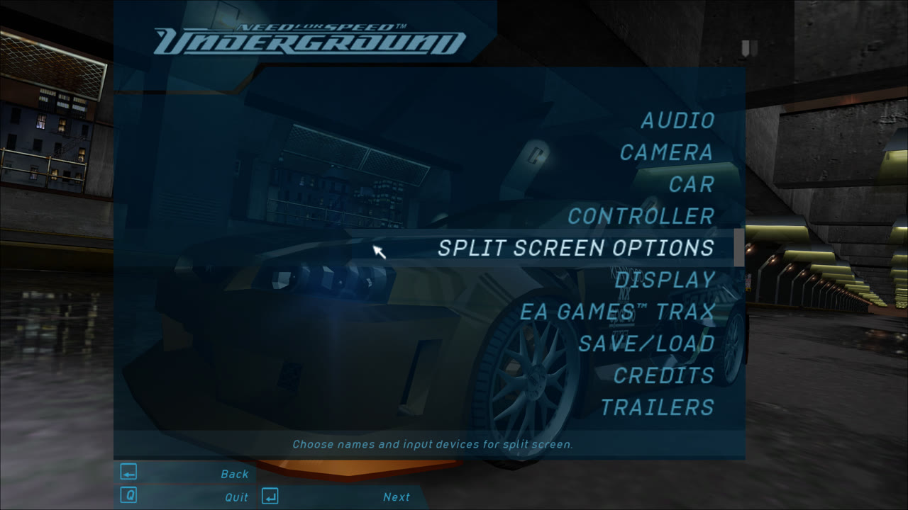
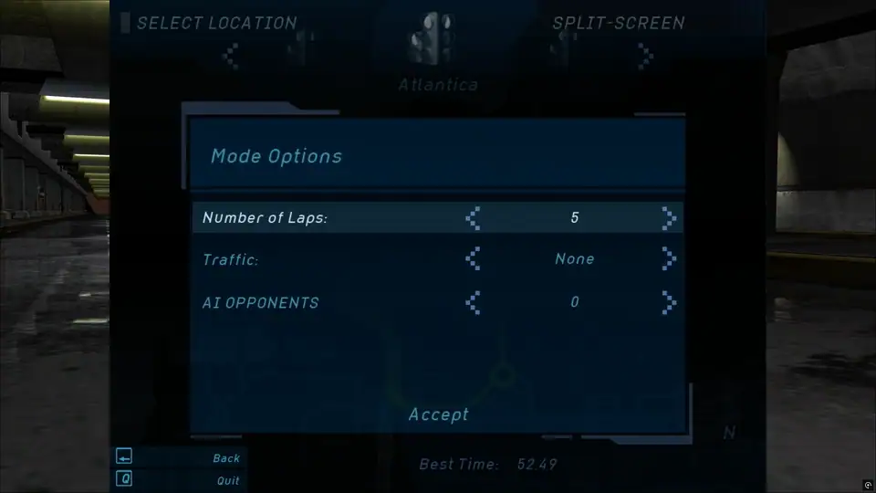

# Need for Speed: Underground — Split Screen Mod

Play Need for Speed: Underground with a friend on the same PC. Split screen divides the display into two views, so you can race together on one monitor.

 

**[Download Mod](https://github.com/nuvsyakoetakoe/nfs-underground-split-screen/releases/latest/download/NFSU1-SplitScreenMod.zip)** · [Installation](#installation) · [Report a bug](#report-a-bug) · **[Русский](docs/README.ru.md)**

## Features

- **Race Modes** - Circuit, Sprint, Drag and Drift.
- **Cars** - all cars unlocked in Split-Screen, including bonus cars.
- **Upgrades** - all upgrades unlocked.
- **Garage** - stock cars and saved custom builds.

 

---

## Player Options

- **Nicknames** - custom names for both players.
- **Input Devices** - a keyboard or gamepad for each player.
- **Device Detection** - press a key or gamepad button in the device list to find your device.

Open **Split Screen Options** to set up both players, then select **Save Settings**.

 

Where to find Split Screen Options

| Open Options in the main menu | Select Split Screen Options |
| --- | --- |
|  |  |

---

## Race Options

- **Laps** - choose the number of laps.
- **Traffic** - set the traffic density.
- **AI Opponents** - choose 0, 1 or 2.

 

---

## Widescreen Fix

- **Resolution** - select a resolution under **Options**, then **Display**. Widescreen Fix is included.

## Installation

1. Start with a clean **Need for Speed: Underground 1.4, English**, for Windows 10 or 11. Back up the game folder before installing.
2. Download **NFSU1-SplitScreenMod.zip** from [Releases](https://github.com/nuvsyakoetakoe/nfs-underground-split-screen/releases/latest).
3. Extract the archive into the folder containing `Speed.exe`, preserving its folders. Allow files to be replaced.
4. Launch `Speed.exe`. Widescreen Fix and Ultimate ASI Loader are included in the archive.

## Start a race

1. Open **Options**, then **Split Screen Options**. Set both players' names and devices, then select **Save Settings**.
2. Choose **Split-Screen** from the main menu.
3. Choose the race mode and track, set the race options, then select each player's car.

 

## Compatibility

| Game | Version | Language | OS |
| --- | --- | --- | --- |
| Need for Speed: Underground (2003), PC | 1.4 | EN | Windows 10 / 11 |

## Report a bug

[Open a bug report](https://github.com/nuvsyakoetakoe/nfs-underground-split-screen/issues/new?template=bug_report.yml). Include your mod version, race mode, input devices, other installed mods and the steps to reproduce the problem. Attach a screenshot or video if possible.

## Credits

- **Split Screen Mod:** [nuvsyakoetakoe](https://github.com/nuvsyakoetakoe).
- **NFS Underground Widescreen Fix:** [ThirteenAG and contributors](https://github.com/ThirteenAG/WidescreenFixesPack/tree/dd0d6c9).
- **Ultimate ASI Loader:** [ThirteenAG and contributors](https://github.com/ThirteenAG/Ultimate-ASI-Loader/tree/6b44066).
- **Direct3D 9 Extensions runtime:** Microsoft.

[Third-party licenses](docs/licenses) · [Build from source](docs/BUILD.md)

Unofficial fan mod. The original game is required and is not included.
