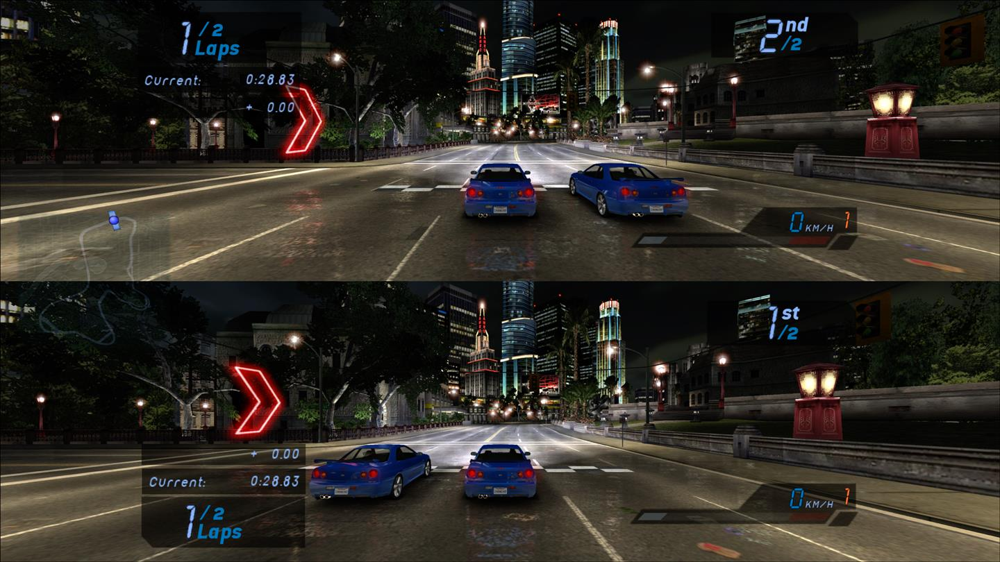

# Need for Speed: Underground — Split Screen

Race a friend on one Windows PC in the original *Need for Speed: Underground*. Each player picks a car from the shared garage, sets a nickname and drives from their own half of the screen.

**[Download the mod (ZIP)](https://github.com/nuvsyakoetakoe/nfs-underground-split-screen/releases/latest/download/NFSU-SplitScreen.zip)** · [Русская инструкция](docs/README.ru.md) · [Release notes](https://github.com/nuvsyakoetakoe/nfs-underground-split-screen/releases)

## Start a race

1. Start with a clean copy of **Need for Speed: Underground 1.4 for Windows**. Keep a copy of the original game folder if you want to undo the installation.
2. Extract **NFSU-SplitScreen.zip** into the folder containing `Speed.exe`. Keep the folder structure and allow files to be replaced.
3. Launch `Speed.exe`. Open **Options → Split Screen Options** to set both nicknames and assign input devices. A keyboard for player one and an XInput gamepad for player two is a good first setup.
4. Select **Split-Screen** from the main menu. Choose a race, then select a car for each player.

## Garage and display

The shared garage lists stock cars alongside saved custom builds. Both players can choose the same model with different tuning. Each car carries its selected parts and upgrades into the race.

The package includes ThirteenAG’s Widescreen Fix. Startup movies are enabled by default. Choose a supported resolution under **Options → Display**. The game saves your selection for the next launch.

## Tested build

| | Verified configuration |
| --- | --- |
| Game | Need for Speed: Underground (2003), Windows PC, patch **1.4** |
| Installation | Release ZIP extracted into a clean 1.4 installation, launched through `Speed.exe` |
| Gameplay check | Local two-player Circuit race at **2560×1440**, with both views and HUDs visible |
| Tested `Speed.exe` SHA-256 | `c0fad450912952f53809a54690d235aa8b4e25b9f46650693c7cbee1b4c074b7` |

To compare your executable, run `Get-FileHash .\Speed.exe -Algorithm SHA256` in PowerShell from the game folder. Other executable builds have not been verified.

## Credits and source

The split-screen plugin, menu changes and build scripts are in this repository. [Build instructions](docs/BUILD.md)

Bundled components include **NFS Underground Widescreen Fix** (build `dd0d6c9`) and **Ultimate ASI Loader** (Win32 9.7.4) by **ThirteenAG and contributors**, and the **Direct3D 9 Extensions** runtime from Microsoft. [Widescreen Fix source](https://github.com/ThirteenAG/WidescreenFixesPack/tree/dd0d6c9) · [Ultimate ASI Loader source](https://github.com/ThirteenAG/Ultimate-ASI-Loader/tree/6b44066) · [Third-party licenses](docs/licenses)

An unofficial fan mod for the original game by EA Black Box and Electronic Arts.
