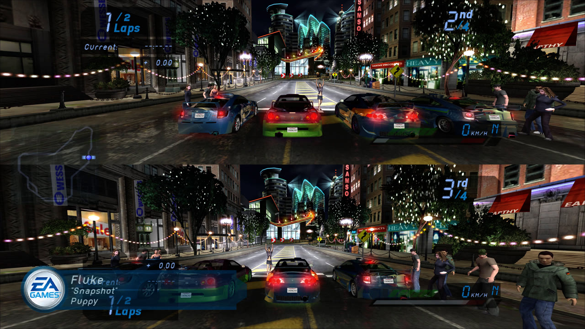
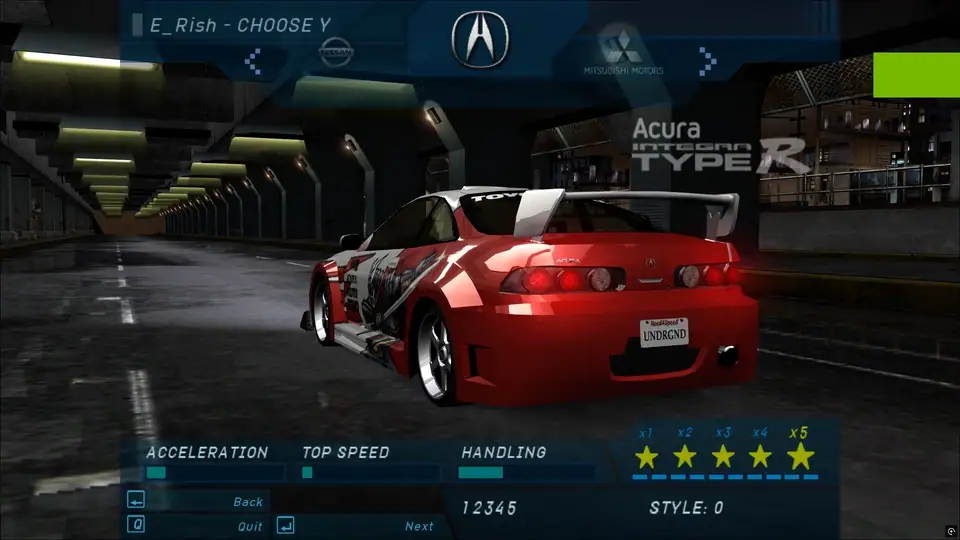
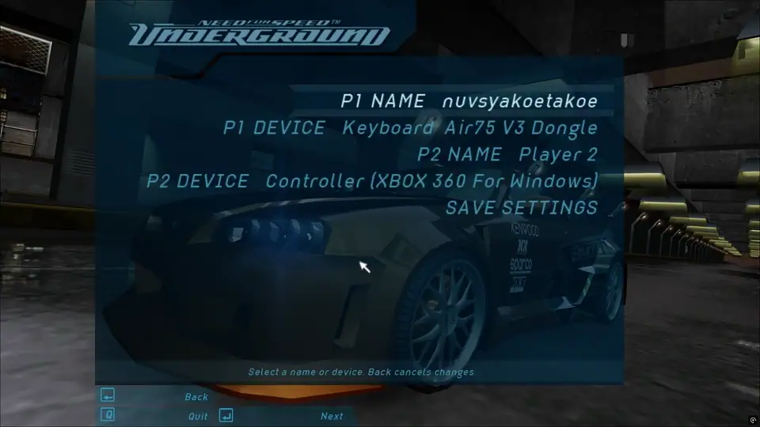
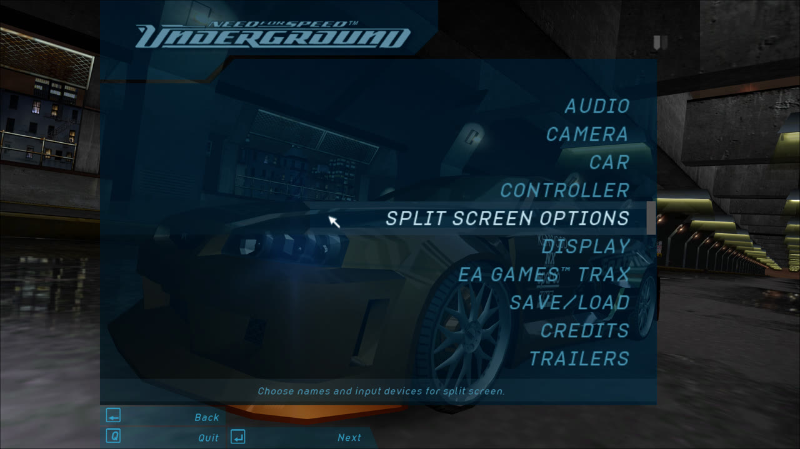
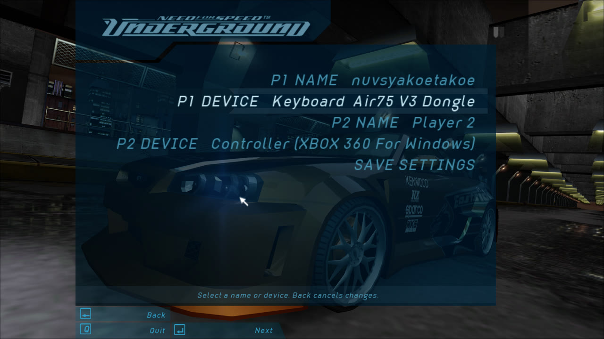
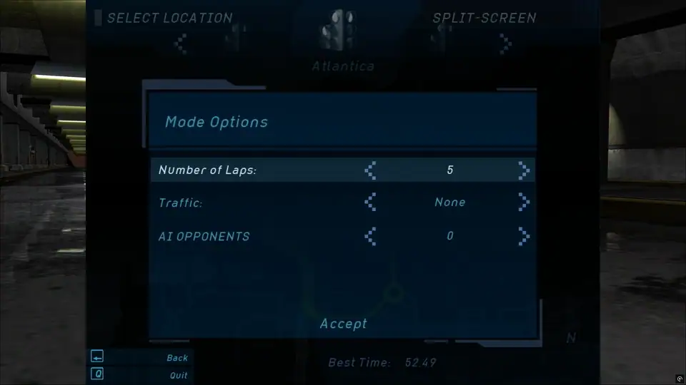
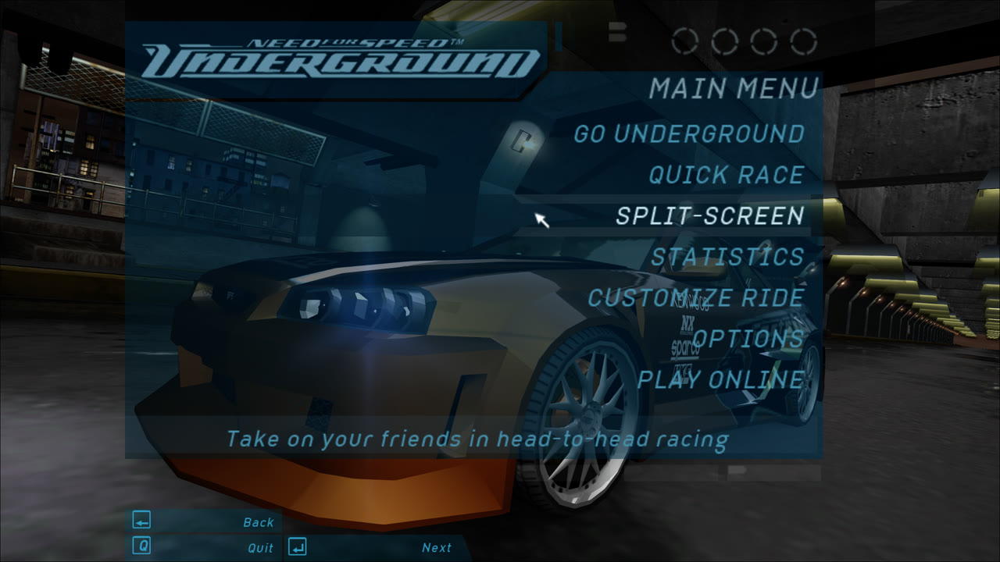

# Need for Speed: Underground — Split Screen Mod

Играй в Need for Speed: Underground с другом на одном ПК. Сплитскрин делит экран на две части, чтобы вы могли гонять вдвоём на одном мониторе.

**[Скачать мод](https://github.com/nuvsyakoetakoe/nfs-underground-split-screen/releases/latest/download/NFSU1-SplitScreenMod.zip)** · [Установка](#установка) · [Сообщить об ошибке](#сообщить-об-ошибке) · **[English](../README.md)**

## Возможности

- **Режимы гонок** - круг, спринт, драг и дрифт.
- **Автомобили** - в Split-Screen разблокированы все машины, включая бонусные.
- **Улучшения** - все улучшения разблокированы.
- **Гараж** - стандартные машины и сохранённые варианты тюнинга.

 

---

## Настройки игроков

- **Ники** - своё имя для каждого игрока.
- **Устройства ввода** - клавиатура или геймпад для каждого игрока.
- **Определение устройства** - нажми клавишу или кнопку геймпада в списке устройств, чтобы найти нужное.

Открой **Split Screen Options**, настрой обоих игроков и выбери **Save Settings**.

 

Где найти Split Screen Options

| Открой Options в главном меню | Выбери Split Screen Options |
| --- | --- |
|  |  |

---

## Настройки гонки

- **Круги** - выбор числа кругов.
- **Трафик** - настройка плотности трафика.
- **AI-соперники** - 0, 1 или 2.

 

---

## Widescreen Fix

- **Разрешение** - выбирается в **Options**, затем **Display**. Widescreen Fix уже в комплекте.

## Установка

1. Подготовь чистую **Need for Speed: Underground 1.4, английскую версию**, для Windows 10 или 11. Сделай резервную копию папки игры.
2. Скачай **NFSU1-SplitScreenMod.zip** из [последнего релиза](https://github.com/nuvsyakoetakoe/nfs-underground-split-screen/releases/latest).
3. Распакуй архив в папку с `Speed.exe`, сохраняя вложенные папки. Разреши замену файлов.
4. Запусти `Speed.exe`. Widescreen Fix и Ultimate ASI Loader уже включены в архив.

## Как начать гонку

1. Открой **Options**, затем **Split Screen Options**. Задай ники и устройства обоих игроков, затем выбери **Save Settings**.
2. Выбери **Split-Screen** в главном меню.
3. Выбери режим и трассу, задай параметры гонки, затем выбери машину для каждого игрока.

 

## Совместимость

| Игра | Версия | Язык | ОС |
| --- | --- | --- | --- |
| Need for Speed: Underground (2003), PC | 1.4 | EN | Windows 10 / 11 |

## Сообщить об ошибке

[Создай баг-репорт](https://github.com/nuvsyakoetakoe/nfs-underground-split-screen/issues/new?template=bug_report.yml). Укажи версию мода, режим гонки, устройства ввода, другие установленные моды и шаги воспроизведения ошибки. По возможности приложи скриншот или видео.

## Авторы

- **Split Screen Mod:** [nuvsyakoetakoe](https://github.com/nuvsyakoetakoe).
- **NFS Underground Widescreen Fix:** [ThirteenAG и участники проекта](https://github.com/ThirteenAG/WidescreenFixesPack/tree/dd0d6c9).
- **Ultimate ASI Loader:** [ThirteenAG и участники проекта](https://github.com/ThirteenAG/Ultimate-ASI-Loader/tree/6b44066).
- **Direct3D 9 Extensions:** Microsoft.

[Лицензии сторонних компонентов](licenses) · [Сборка из исходников](BUILD.md)

Неофициальный фанатский мод. Оригинальная игра необходима и в комплект не входит.
