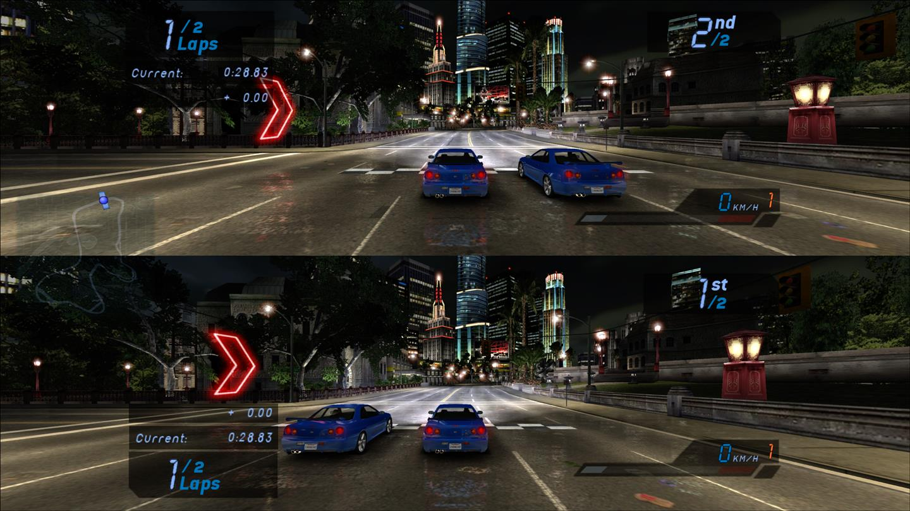

# Need for Speed: Underground — Split Screen 1.0.0

**Two players. One PC. Olympic City.** Play the original Need for Speed: Underground in horizontal split screen on Windows.

[English guide](https://github.com/nuvsyakoetakoe/nfs-underground-split-screen#readme) · [Русская инструкция](https://github.com/nuvsyakoetakoe/nfs-underground-split-screen/blob/main/docs/README.ru.md)

## Features

- Local two-player racing with separate cameras and HUDs.
- Shared garage with stock cars and saved custom builds; choose the same model with different tuning.
- Player nicknames and input assignments under **Options → Split Screen Options**.
- Keyboard and XInput gamepad controls.
- Bundled Widescreen Fix and Ultimate ASI Loader.

## Installation

1. Back up a clean **Windows PC version 1.4** game folder. The mod replaces menu and shader resources.
2. Download **NFSU-SplitScreen.zip** from **Assets** below. The Source code archives are for developers.
3. Extract the ZIP beside `Speed.exe`, preserving folders and allowing replacement.
4. Launch `Speed.exe`. Open **Options → Split Screen Options**, assign names and devices, and select **Save Settings**.
5. Select **Split-Screen** in the main menu, choose a race, then choose each player's car.

For a first race, use a keyboard for player one and an XInput gamepad for player two. Set the resolution in **Options → Display**. Startup movies are enabled by default.

## Compatibility

| Game | Version | Language |
| --- | --- | --- |
| Need for Speed: Underground (2003), Windows PC | 1.4 | EN |

## Credits

Widescreen Fix and Ultimate ASI Loader by **ThirteenAG and contributors**; Direct3D 9 Extensions runtime by **Microsoft**. [Credits and third-party licenses](https://github.com/nuvsyakoetakoe/nfs-underground-split-screen#credits).

Unofficial fan mod. The original game is required and is not included.
